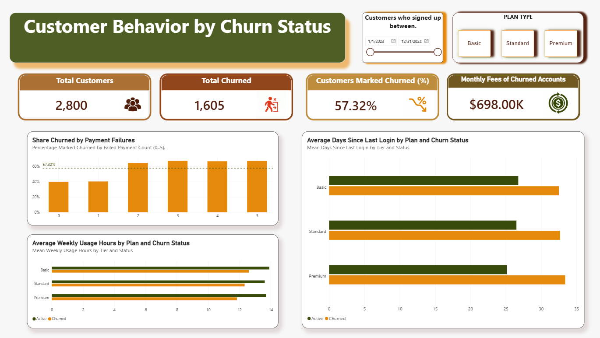

# SaaS Customer Churn & Behavioral Retention Analysis

In a snapshot of **2,800 SaaS customers**, **40.12%** of customers with one recorded payment failure were marked churned, compared with **64.23%** of those with two. This Python and Power BI project examines that difference alongside support activity, product usage, and subscription plan to identify a group for a payment-recovery test.

[Read the analysis with charts](notebooks/saas_eda.md) · [Open the Python notebook](notebooks/saas_eda.ipynb)

## When to test payment-recovery outreach

The notebook reports a median of three failed payments among customers marked churned. To decide when to test outreach, the table compares the share marked churned among all customers with each failure count.

| Recorded payment failures | Customers | Customers marked churned | Churn share |
| ---: | ---: | ---: | ---: |
| 0 | 442 | 175 | 39.59% |
| 1 | 496 | 199 | 40.12% |
| **2** | **478** | **307** | **64.23%** |
| 3 | 471 | 316 | 67.09% |
| 4 | 453 | 301 | 66.45% |
| 5 | 460 | 307 | 66.74% |

The **24.1-percentage-point difference between one and two failures** is the largest between adjacent failure counts. Across all customers with two or more failures, **1,231 of 1,862 (66.11%)** were marked churned.

**Proposed test.** After a second failed payment, randomly assign eligible accounts to the usual billing process or the same process plus a payment-update reminder. Compare the percentage of accounts that settle the overdue invoice within seven days. Measuring that outcome would require dated failure and settlement records.

## What else the data shows

- **Support activity overlaps with billing issues.** Churn share ranged from **45.80% to 55.99%** across groups with zero to four tickets. At five tickets, **200 of 294 customers (68.03%)** were marked churned. In total, **808 customers** had both five or more tickets and two or more failed payments.
- **Customers marked churned used the product less across all three plans.** Overall, they averaged **12.25 hours of weekly usage** and **32.88 days since last login**. Active customers averaged **13.75 hours** and **26.15 days**, respectively. The snapshot establishes the difference between groups. Determining whether inactivity preceded cancellation would require cancellation dates.
- **Churn share was similar across plans.** The observed shares were **57.85% for Basic**, **56.06% for Standard**, and **58.05% for Premium**, a spread of about two percentage points.

## Data and metric definitions

Each row represents one customer. Signup dates span **January 1, 2023 through December 31, 2024**. The committed CSV contains **2,800 unique customer IDs**, ten source fields, and zero missing values. The matching public dataset is cataloged as synthetic. [Raw CSV used in this project](data/raw/customer_subscription_churn_usage_patterns.csv) · [Dataset on Kaggle](https://www.kaggle.com/datasets/jayjoshi37/customer-subscription-churn-and-usage-patterns)

**Churn share** is the number of distinct customers marked `churn = "Yes"` divided by the number of distinct customers in the selected group. Overall, **1,605 customers (57.32%)** were marked churned and **1,195** were active. The date filter groups customers by when they signed up. Calculating cancellations by month or historical recurring revenue would require dated cancellations and subscription or billing history.

## Power BI dashboard

Both report pages use synchronized **Signup Date** and **Plan Type** slicers. The churn-share charts use **57.32%** as a fixed full-dataset reference.

| Report page | What it shows |
| --- | --- |
| **Executive Overview** | Customer and churn counts, active accounts’ recorded monthly fees, churn share by plan and support ticket count, and customer signups by month. |
| **Customer Behavior by Churn Status** | Churn share by payment failure count, recorded monthly fees for churned accounts, and comparisons of average weekly usage and days since last login within each plan. |

[Download the Power BI report (.pbix)](dashboard/saas-churn-analytics-visualization.pbix?raw=true)




<details>
<summary>Power BI model names and DAX measures</summary>

| Name in the PBIX | Report label or meaning | DAX | Full dataset |
| --- | --- | --- | ---: |
| `Total Customers` | Total Customers | `DISTINCTCOUNT('clean_saas_data'[user_id])` | 2,800 |
| `Total Churned` | Total Churned | `CALCULATE([Total Customers], 'clean_saas_data'[churn] = "Yes")` | 1,605 |
| `Churn Rate %` | Customers Marked Churned (%) | See formula below | 57.32% |
| `Total Monthly Fees` | Sum of recorded monthly fees across all accounts | `SUM('clean_saas_data'[monthly_fee])` | 1,215,800 |
| `Active Monthly Fees` | Active Monthly Fees | `CALCULATE([Total Monthly Fees], 'clean_saas_data'[churn] = "No")` | 517,805 |
| `Churned Monthly Fees` | Monthly Fees of Churned Accounts | `CALCULATE([Total Monthly Fees], 'clean_saas_data'[churn] = "Yes")` | 697,995 |

```dax
Churn Rate % =
VAR CustomersInGroup =
    CALCULATE(
        [Total Customers],
        REMOVEFILTERS('clean_saas_data'[churn])
    )
RETURN
    DIVIDE(COALESCE([Total Churned], 0), CustomersInGroup)
```

The behavior charts use a calculated column for the legend.

```dax
Account Status =
IF('clean_saas_data'[churn] = "Yes", "Churned", "Active")
```

</details>

## Repository contents

| File or folder | Purpose |
| --- | --- |
| [dashboard/](dashboard/) | Published Power BI report (`saas-churn-analytics-visualization.pbix`) and dashboard screenshots (`executive_overview.png`, `behavioral_drivers.png`) |
| [data/raw/customer_subscription_churn_usage_patterns.csv](data/raw/customer_subscription_churn_usage_patterns.csv) | Source snapshot read by the notebook |
| [data/clean/clean_saas_data.csv](data/clean/clean_saas_data.csv) | Validated export used by Power BI |
| [notebooks/saas_eda.ipynb](notebooks/saas_eda.ipynb) | Python analysis and saved outputs |
| [notebooks/saas_eda.md](notebooks/saas_eda.md) | Rendered analysis with charts and written findings |
| [notebooks/saas_eda_files/](notebooks/saas_eda_files/) | Five chart images used in the Markdown export |

## Reproduce the analysis

From the repository root, use a Python 3.12 environment and launch the notebook.

```bash
python -m pip install jupyterlab pandas==2.2.3 numpy==2.3.5 matplotlib==3.10.8 seaborn==0.13.2
cd notebooks
jupyter lab saas_eda.ipynb
```

Run all cells in order. The notebook reads the raw CSV, checks missing values and data types, parses `signup_date`, and writes `../data/clean/clean_saas_data.csv`. The source already uses `YYYY-MM-DD`, so the export reproduces the committed CSV byte-for-byte.

For a local copy of the Power BI report, point the `clean_saas_data` query’s **Source** step to `data/clean/clean_saas_data.csv` on your machine and refresh. With both slicers cleared, the customer count should be **2,800** and the share marked churned should be **57.32%**.

<details>
<summary>Reproduce the payment-failure table after running the notebook</summary>

```python
billing = (
    df.assign(marked_churned=df["churn"].eq("Yes"))
    .groupby("payment_failures")
    .agg(customers=("user_id", "nunique"), churned=("marked_churned", "sum"))
)
billing["churn_share_pct"] = (100 * billing["churned"] / billing["customers"]).round(2)
print(billing)
```

</details>