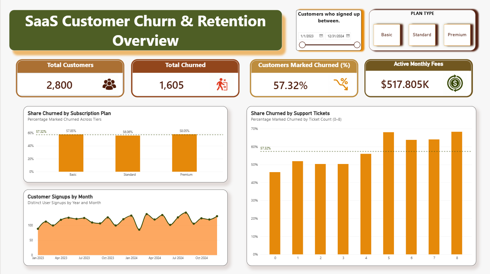

# SaaS Customer Churn & Behavioral Retention Analysis

An end-to-end exploratory data analysis (Python) and interactive two-page Power BI dashboard examining subscription revenue, billing friction, and user engagement across **2,800 SaaS subscriber records**.

---

## Key Business Recommendation

* **Test Automated Payment-Recovery Outreach After the 2nd Failed Payment:** Customers with **1 failed payment** had a **40.12% churn share (199 / 496)**, whereas customers with **2 failed payments** jumped to **64.23% (307 / 478)**—a **24.11 percentage-point surge** that remains above 66% for 3–5 failures (66.11% overall for 2+ failures; 1,231 / 1,862). Prioritizing automated dunning retries, card-updater prompts, and billing grace-period outreach immediately after a second failure targets the sharpest inflection point in the dataset.

---

## Additional Analytical Takeaways

* **Support Friction Escalates at 5+ Tickets (and Overlaps with Billing Issues):** Churn share sits between 52% and 56% for 0–4 support tickets (55.99% at 4 tickets; 159 / 284), then rises to **68.03% at 5 tickets** and remains elevated across 5–8 tickets. While `payment_failures` and `support_tickets` show weak linear correlation, they do not affect separate populations: **808 customers** experienced both **2+ failed payments and 5+ support tickets**.
* **Consistent Engagement & Inactivity Gaps Across All Plans:** Churned accounts average **12.25 weekly usage hours** and **32.88 days since last login**, compared with **13.75 hours** and **26.15 days** for active accounts. Because the dataset lacks cancellation timestamps, the last-login gap reflects snapshot status rather than proof that login drop-off preceded cancellation.
* **Pricing Tier Alone Does Not Drive Churn:** Share marked churned varies by less than 2 percentage points across **Standard (56.06%)**, **Basic (57.85%)**, and **Premium (58.05%)**.

---

## Interactive Power BI Dashboard

The Power BI report separates business performance monitoring from behavioral segmentation across two pages, synchronized by **Signup Date** (`Customers who signed up between`) and **Plan Type** (`Basic`, `Standard`, `Premium`).

### 1. Executive Overview


### 2. Customer Behavior by Churn Status


---

## DAX Measure & Model Reference

| Measure / Column | DAX Formula | Description |
| :--- | :--- | :--- |
| **Total Customers** | `DISTINCTCOUNT('clean_saas_data'[user_id])` | Unique customer count (`2,800` unfiltered). |
| **Total Churned** | `CALCULATE([Total Customers], 'clean_saas_data'[churn] = "Yes")` | Count of accounts marked churned (`1,605`). |
| **Customers Marked Churned (%)** | `VAR CustomersInGroup = CALCULATE([Total Customers], REMOVEFILTERS('clean_saas_data'[churn])) RETURN DIVIDE(COALESCE([Total Churned], 0), CustomersInGroup)` | Share marked churned within the active filter/group (`57.32%` overall). |
| **Total Monthly Fees** | `SUM('clean_saas_data'[monthly_fee])` | Combined recorded monthly fees across all 2,800 accounts (`1,215,800`). |
| **Active Customer Monthly Fees** | `CALCULATE([Total Monthly Fees], 'clean_saas_data'[churn] = "No")` | Recorded monthly fees for the 1,195 active accounts (`517,805`). |
| **Monthly Fees of Churned Accounts** | `CALCULATE([Total Monthly Fees], 'clean_saas_data'[churn] = "Yes")` | Recorded monthly fees for the 1,605 churned accounts (`697,995`). |
| **Account Status** *(Column)* | `IF('clean_saas_data'[churn] = "Yes", "Churned", "Active")` | Readable status labels for behavioral comparisons. |

---

## Repository Structure

```text
├── data/
│   └── clean/
│       └── clean_saas_data.csv                     # Cleaned 2,800-row dataset used by Power BI
├── notebooks/
│   ├── saas_eda.ipynb                              # Python EDA, statistical checks & chart tables
│   └── saas_eda.md                                 # Markdown export of the executed notebook
├── dashboard/
│   ├── saas-churn-analytics-visualization.pbix     # Power BI Desktop report
│   ├── executive_overview.png                      # Page 1 screenshot
│   └── behavioral_drivers.png                      # Page 2 screenshot
└── README.md