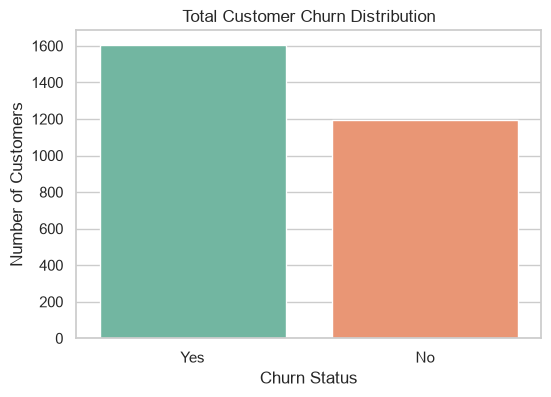
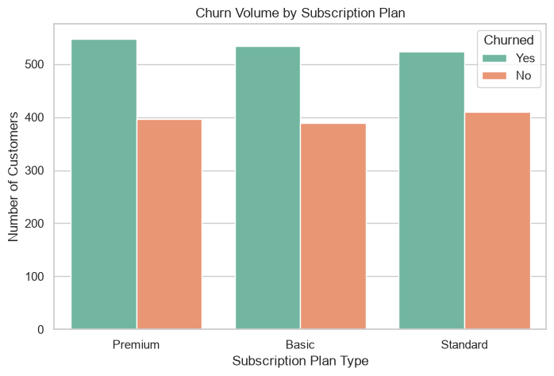
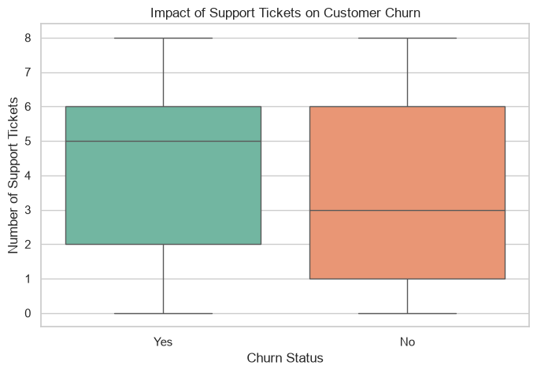
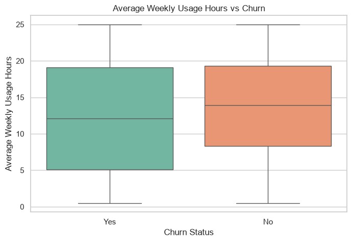
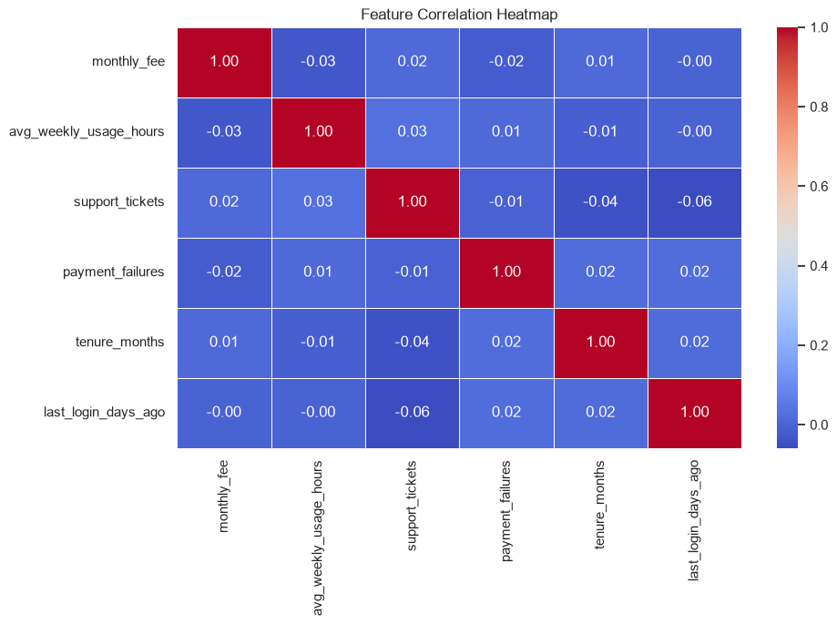

```python
import pandas as pd
import numpy as np
import matplotlib.pyplot as plt
import seaborn as sns
```


```python
df = pd.read_csv('../data/raw/customer_subscription_churn_usage_patterns.csv')
```


```python
# Preview ng data
df.head()
```


<div>
<style scoped>
    .dataframe tbody tr th:only-of-type {
        vertical-align: middle;
    }

    .dataframe tbody tr th {
        vertical-align: top;
    }

    .dataframe thead th {
        text-align: right;
    }
</style>
<table border="1" class="dataframe">
  <thead>
    <tr style="text-align: right;">
      <th></th>
      <th>user_id</th>
      <th>signup_date</th>
      <th>plan_type</th>
      <th>monthly_fee</th>
      <th>avg_weekly_usage_hours</th>
      <th>support_tickets</th>
      <th>payment_failures</th>
      <th>tenure_months</th>
      <th>last_login_days_ago</th>
      <th>churn</th>
    </tr>
  </thead>
  <tbody>
    <tr>
      <th>0</th>
      <td>1</td>
      <td>2023-04-15</td>
      <td>Premium</td>
      <td>699</td>
      <td>1.1</td>
      <td>4</td>
      <td>1</td>
      <td>8</td>
      <td>14</td>
      <td>Yes</td>
    </tr>
    <tr>
      <th>1</th>
      <td>2</td>
      <td>2023-08-27</td>
      <td>Premium</td>
      <td>699</td>
      <td>2.6</td>
      <td>6</td>
      <td>0</td>
      <td>35</td>
      <td>1</td>
      <td>Yes</td>
    </tr>
    <tr>
      <th>2</th>
      <td>3</td>
      <td>2023-10-12</td>
      <td>Premium</td>
      <td>699</td>
      <td>14.3</td>
      <td>8</td>
      <td>3</td>
      <td>2</td>
      <td>14</td>
      <td>Yes</td>
    </tr>
    <tr>
      <th>3</th>
      <td>4</td>
      <td>2023-12-11</td>
      <td>Basic</td>
      <td>199</td>
      <td>17.6</td>
      <td>5</td>
      <td>2</td>
      <td>11</td>
      <td>9</td>
      <td>Yes</td>
    </tr>
    <tr>
      <th>4</th>
      <td>5</td>
      <td>2023-02-14</td>
      <td>Basic</td>
      <td>199</td>
      <td>9.8</td>
      <td>5</td>
      <td>2</td>
      <td>6</td>
      <td>38</td>
      <td>Yes</td>
    </tr>
  </tbody>
</table>
</div>


```python
# function para makita yung data types columns and non-null counts
df.info()

#  exact number ng missing values kada column
df.isnull().sum()
```

    <class 'pandas.DataFrame'>
    RangeIndex: 2800 entries, 0 to 2799
    Data columns (total 10 columns):
     #   Column                  Non-Null Count  Dtype  
    ---  ------                  --------------  -----  
     0   user_id                 2800 non-null   int64  
     1   signup_date             2800 non-null   str    
     2   plan_type               2800 non-null   str    
     3   monthly_fee             2800 non-null   int64  
     4   avg_weekly_usage_hours  2800 non-null   float64
     5   support_tickets         2800 non-null   int64  
     6   payment_failures        2800 non-null   int64  
     7   tenure_months           2800 non-null   int64  
     8   last_login_days_ago     2800 non-null   int64  
     9   churn                   2800 non-null   str    
    dtypes: float64(1), int64(6), str(3)
    memory usage: 218.9 KB
    


    user_id                   0
    signup_date               0
    plan_type                 0
    monthly_fee               0
    avg_weekly_usage_hours    0
    support_tickets           0
    payment_failures          0
    tenure_months             0
    last_login_days_ago       0
    churn                     0
    dtype: int64


```python
# summary statistics
df.describe()

```


<div>
<style scoped>
    .dataframe tbody tr th:only-of-type {
        vertical-align: middle;
    }

    .dataframe tbody tr th {
        vertical-align: top;
    }

    .dataframe thead th {
        text-align: right;
    }
</style>
<table border="1" class="dataframe">
  <thead>
    <tr style="text-align: right;">
      <th></th>
      <th>user_id</th>
      <th>monthly_fee</th>
      <th>avg_weekly_usage_hours</th>
      <th>support_tickets</th>
      <th>payment_failures</th>
      <th>tenure_months</th>
      <th>last_login_days_ago</th>
    </tr>
  </thead>
  <tbody>
    <tr>
      <th>count</th>
      <td>2800.000000</td>
      <td>2800.000000</td>
      <td>2800.000000</td>
      <td>2800.000000</td>
      <td>2800.000000</td>
      <td>2800.000000</td>
      <td>2800.000000</td>
    </tr>
    <tr>
      <th>mean</th>
      <td>1400.500000</td>
      <td>434.214286</td>
      <td>12.891429</td>
      <td>3.887857</td>
      <td>2.491786</td>
      <td>18.612857</td>
      <td>30.005000</td>
    </tr>
    <tr>
      <th>std</th>
      <td>808.434702</td>
      <td>205.678472</td>
      <td>7.109691</td>
      <td>2.606419</td>
      <td>1.691647</td>
      <td>10.374487</td>
      <td>17.852757</td>
    </tr>
    <tr>
      <th>min</th>
      <td>1.000000</td>
      <td>199.000000</td>
      <td>0.500000</td>
      <td>0.000000</td>
      <td>0.000000</td>
      <td>1.000000</td>
      <td>0.000000</td>
    </tr>
    <tr>
      <th>25%</th>
      <td>700.750000</td>
      <td>199.000000</td>
      <td>6.700000</td>
      <td>2.000000</td>
      <td>1.000000</td>
      <td>10.000000</td>
      <td>14.000000</td>
    </tr>
    <tr>
      <th>50%</th>
      <td>1400.500000</td>
      <td>399.000000</td>
      <td>12.800000</td>
      <td>4.000000</td>
      <td>2.000000</td>
      <td>18.000000</td>
      <td>30.000000</td>
    </tr>
    <tr>
      <th>75%</th>
      <td>2100.250000</td>
      <td>699.000000</td>
      <td>19.200000</td>
      <td>6.000000</td>
      <td>4.000000</td>
      <td>27.000000</td>
      <td>46.000000</td>
    </tr>
    <tr>
      <th>max</th>
      <td>2800.000000</td>
      <td>699.000000</td>
      <td>25.000000</td>
      <td>8.000000</td>
      <td>5.000000</td>
      <td>36.000000</td>
      <td>60.000000</td>
    </tr>
  </tbody>
</table>
</div>


```python
# Convert signup_date s proper datetime format
df['signup_date'] = pd.to_datetime(df['signup_date'])

# kaya nag print para makita if naconvert ba signup_date  from 'object' (string) to 'datetime64'
print(df[['signup_date']].dtypes)
```

    signup_date    datetime64[us]
    dtype: object
    


```python
# save dataframe sa clean data folder
df.to_csv('../data/clean/clean_saas_data.csv', index=False)

print("Clean dataset successfully exported to /data/clean/clean_saas_data.csv!")
```

    Clean dataset successfully exported to /data/clean/clean_saas_data.csv!
    

## Exploratory Data Analysis (EDA)
Investigating behavioral, financial, and support-related drivers behind customer churn across 2,800 subscriber records.


```python
# Set default styling for all charts
sns.set_theme(style="whitegrid")
```


```python
# Plot overall churn count
plt.figure(figsize=(6, 4))
sns.countplot(data=df, x='churn', hue='churn', palette='Set2', legend=False)
plt.title('Total Customer Churn Distribution')
plt.xlabel('Churn Status')
plt.ylabel('Number of Customers')
plt.show()

# Print natin yung exact numbers and percentages
churn_counts = df['churn'].value_counts()
churn_percentage = df['churn'].value_counts(normalize=True) * 100
print("--- Churn Breakdown ---")
print(churn_counts)
print("\n--- Churn Percentage ---")
print(churn_percentage)
```


    

    


    --- Churn Breakdown ---
    churn
    Yes    1605
    No     1195
    Name: count, dtype: int64
    
    --- Churn Percentage ---
    churn
    Yes    57.321429
    No     42.678571
    Name: proportion, dtype: float64
    

### Key Takeaway: Baseline Churn Rate
* **Observation:** Out of 2,800 total subscribers, **1,605 customers (57.32%)** have canceled their subscriptions, compared to **1,195 active users (42.68%)**.
* **Business Impact:** Losing more than half of the customer base indicates a severe retention bottleneck. This **57.32%** figure serves as our benchmark subsequent analysis will isolate which pricing tiers, support friction levels, and usage behaviors push churn above this baseline.


```python
# Plot churn volume by subscription plan
plt.figure(figsize=(8, 5))
sns.countplot(data=df, x='plan_type', hue='churn', palette='Set2')
plt.title('Churn Volume by Subscription Plan')
plt.xlabel('Subscription Plan Type')
plt.ylabel('Number of Customers')
plt.legend(title='Churned')
plt.show()

# Here we added pd.crosstab to print exact churn percentage within each plan tier
plan_churn_rate = pd.crosstab(df['plan_type'], df['churn'], normalize='index') * 100
print("--- Churn Rate (%) by Subscription Plan ---")
print(plan_churn_rate.round(2))
```


    

    


    --- Churn Rate (%) by Subscription Plan ---
    churn         No    Yes
    plan_type              
    Basic      42.15  57.85
    Premium    41.95  58.05
    Standard   43.94  56.06
    

### Key Takeaway: Churn by Subscription Plan
* **Observation:** Churn rates are nearly identical across all tiers Premium leads slightly at 58.05%, followed by Basic at 57.85% and Standard at 56.06%.
* **So What:** Because every tier sits right near our 57.32% overall average, plan pricing alone isn't driving customers away. However, losing Premium subscribers hurts revenue the most, so retaining high-tier users should be a priority once we uncover the behavioral triggers.


```python
# Boxplot comparing support tickets for churned vs active users
plt.figure(figsize=(8, 5))
sns.boxplot(data=df, x='churn', y='support_tickets', hue='churn', palette='Set2', legend=False)
plt.title('Impact of Support Tickets on Customer Churn')
plt.xlabel('Churn Status')
plt.ylabel('Number of Support Tickets')
plt.show()

# Print summary stats to get exact median and mean ticket counts
print(df.groupby('churn')['support_tickets'].describe())

```


    

    


            count      mean       std  min  25%  50%  75%  max
    churn                                                     
    No     1195.0  3.435983  2.565369  0.0  1.0  3.0  6.0  8.0
    Yes    1605.0  4.224299  2.586563  0.0  2.0  5.0  6.0  8.0
    

### Key Takeaway: Support Friction vs. Churn
* **Observation:** Churned customers have a median of 5 support tickets (mean: 4.22), compared to a median of 3 tickets (mean: 3.44) for active users.
* **So What:** High support volume is a clear red flag for cancellation. Flagging accounts for proactive outreach as soon as they log their 4th support ticket could help resolve issues before users decide to leave.


```python
# Boxplot comparing weekly usage hours for churned vs active users
plt.figure(figsize=(8, 5))
sns.boxplot(data=df, x='churn', y='avg_weekly_usage_hours', hue='churn', palette='Set2', legend=False)
plt.title('Average Weekly Usage Hours vs Churn')
plt.xlabel('Churn Status')
plt.ylabel('Average Weekly Usage Hours')
plt.show()

# Print summary stats for usage hours
print(df.groupby('churn')['avg_weekly_usage_hours'].describe())
```


    

    


            count       mean       std  min   25%   50%   75%   max
    churn                                                          
    No     1195.0  13.746444  6.609131  0.5  8.35  13.9  19.3  25.0
    Yes    1605.0  12.254829  7.398706  0.5  5.10  12.1  19.1  25.0
    

### Key Takeaway: Product Engagement vs. Churn
* **Observation:** Churned users average 12.25 weekly usage hours (median: 12.1), down from 13.75 hours (median: 13.9) for active subscribers. Additionally, 25% of churned users log 5.1 hours or less per week.
* **So What:** Usage dropping below 8 hours per week and especially under 5 hours signals low product adoption. Triggering automated onboarding tips or check-in emails when weekly usage dips below 6 hours can help re-engage at-risk accounts.


```python
# Calculate correlation matrix for numerical business metrics (excluding user_id)
plt.figure(figsize=(10, 6))
numeric_df = df.drop(columns=['user_id']).select_dtypes(include=[np.number])
sns.heatmap(numeric_df.corr(), annot=True, cmap='coolwarm', fmt=".2f", linewidths=0.5)
plt.title('Feature Correlation Heatmap')
plt.show()
```


    

    


```python
# Check overlap between high payment failures (2+) and high support tickets (5+)
overlap_mask = (df["payment_failures"] >= 2) & (df["support_tickets"] >= 5)
overlap_count = df.loc[overlap_mask, "user_id"].nunique()
print(f"Customers with 2+ payment failures AND 5+ support tickets: {overlap_count}")
```

    Customers with 2+ payment failures AND 5+ support tickets: 808
    

### Key Takeaway: Feature Correlation Heatmap

* **Observation:** Linear correlations among the numeric features are near zero, ranging from -0.06 (`support_tickets` vs. `last_login_days_ago`) to 0.03 (`avg_weekly_usage_hours` vs. `support_tickets`), and the matrix excludes the text-based `churn` target. However, cross-tabulating high-risk thresholds reveals that **808 customers (28.86% of the dataset)** experienced **both** 2+ payment failures and 5+ support tickets.
* **So What:** Near-zero linear correlation does not establish independence or mean that billing friction and support issues affect completely separate user groups. Because nearly a third of subscribers experience both issues simultaneously, we still track engagement, support volume, and payment failures as distinct visuals in Power BI to isolate their individual inflection points while accounting for compounded churn risk.


```python
# Compare median and mean across remaining numerical metrics by churn status
remaining_metrics = ['payment_failures', 'tenure_months', 'last_login_days_ago']
print("--- Median Values by Churn Status ---")
print(df.groupby('churn')[remaining_metrics].median())

print("\n--- Mean Values by Churn Status ---")
print(df.groupby('churn')[remaining_metrics].mean().round(2))
```

    --- Median Values by Churn Status ---
           payment_failures  tenure_months  last_login_days_ago
    churn                                                      
    No                  2.0           18.0                 22.0
    Yes                 3.0           18.0                 34.0
    
    --- Mean Values by Churn Status ---
           payment_failures  tenure_months  last_login_days_ago
    churn                                                      
    No                 2.07          18.59                26.15
    Yes                2.80          18.63                32.88
    

### Key Takeaway: Billing Friction, Inactivity, and Tenure
* **Observation:** Churned users average 34.0 median days since their last login (vs. 22.0 days for active users) and 3.0 median payment failures (vs. 2.0 for active users). Meanwhile, median tenure sits at exactly 18.0 months for both groups.
* **So What:** Long-term customers are just as likely to cancel as newer ones. Real retention risks come from inactivity past 30 days and repeated billing failures—meaning automated re-engagement emails at day 25 of inactivity and better failed-payment recovery after the 2nd failure can directly reduce churn.

## Summary 
* **Baseline Churn:** 57.32% (1,605 of 2,800 subscribers).
* **Non-Drivers:** Subscription tier (`plan_type`) and account age (`tenure_months`) show nearly identical rates across active and churned groups.
* **Top 4 Churn Drivers:**
  1. **Account Inactivity:** Last login exceeding 30 days (median 34 days for churned users).
  2. **Support Friction:** Reaching 4 to 5+ support tickets (median 5 tickets vs. 3 for active).
  3. **Billing Failures:** Hitting 3+ payment failures (median 3 vs. 2 for active).
  4. **Low Weekly Usage:** Dropping below 8 hours/week (25% of churned users log 5.1 hours or less).

